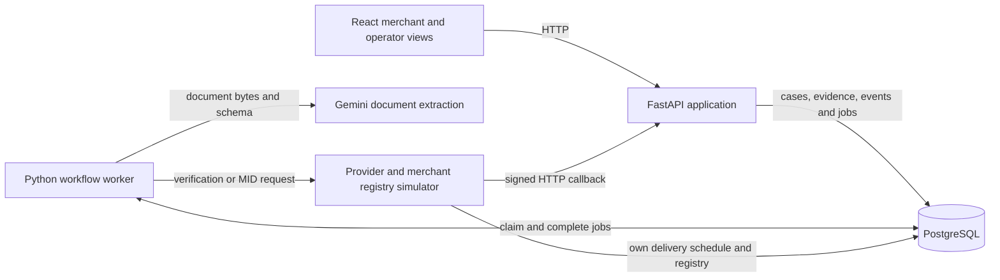

# Autonomous Merchant Onboarding Platform — development plan

Build a merchant onboarding desk that can approve a complete application on its own and tell a person exactly what to fix when a check fails. An operator should be able to open any case and see what blocks approval, which evidence explains it and who can act next.

The chosen stack is **React with TypeScript, Tailwind CSS and shadcn/ui**, backed by **FastAPI and PostgreSQL**. The plan assumes one developer, synthetic Indian merchant data and a local Docker Compose demo. The submission email sets the deadline at **Sunday, 22 November 2026, 18:00 IST**. The functional requirements come from the [case study](PS.md).

## The four-minute demo

1. Submit a fictional merchant, **Riverbend Stationery**, with a PAN document and an old GST certificate. Open the extracted GSTIN beside its source. The value matches the application form.
2. Watch two independent requests leave for the simulated PAN and GST services. PAN passes. The GST callback reports that this registration is inactive. The operator sees the exact blocker, the successful PAN result and the absence of a merchant ID.
3. The operator requests a current GST certificate and records the reason. The merchant opens the request, replaces the certificate and updates the declared GSTIN. The new registration belongs to the same merchant. Only the GST check needs to run again.
4. The second GST callback passes and closes the GST review item. Once all configured checks pass and all blockers are resolved, the application is approved automatically. The merchant registry returns one merchant ID (MID). The timeline links the decision to the evidence revisions and check attempts.
5. Redeliver the successful callback through the simulator. Show two deliveries, one applied result, one approval and the same merchant ID. A fresh application using the current certificate can demonstrate straight-through approval without operator intervention.

The old and replacement GSTINs have different records in the simulated registry. Submitting the old certificate again reproduces the failure. The field match in step 1 and the provider failure in step 2 demonstrate two distinct facts about the same document.

## Feature commitments

| Priority | Features | Acceptance |
| --- | --- | --- |
| Working submission | Merchant intake with independently supplied structured documents, field extraction and validation, PAN and GST simulators, signed asynchronous callbacks, explicit state transitions, operator queue, correction and resubmission, gated approval, merchant ID issuance and audit history | The entire demo runs through the browser with the bundled PAN JSON and GST certificates. Refreshing the page preserves progress. |
| Submission target | Use Gemini to classify and extract PAN or GST evidence from an uploaded PDF, PNG, JPEG or WebP with unfamiliar wording or layout. Include the source page, quoted evidence and extraction method. | A new layout with no matching filename or template yields the correct fields. Unknown documents, unreadable identifiers and conflicting evidence route to the operator or merchant. |
| Local fallback | Read structured JSON directly and use labelled PDF text or local OCR for supported fixtures when Gemini is unavailable. Record which reader produced the values. | The evaluator can complete the bundled correction journey without a hosted credential. Quota or provider outages are visible technical events. |
| After submission | Add a bank verifier and invalidate its result when bank details change. Further extensions include a risk simulator, duplicate-application matching and queue metrics. | The bank acceptance scenario below defines the first extension. |

The release covers PAN and GST. Use the tested `gemini-flash-lite-latest` REST endpoint with inline document input and schema-constrained JSON output. An isolated cURL text probe and a Python image probe both returned HTTP 200 on 21 November 2026. The alias resolved to `gemini-3.5-flash-lite` and identified all three drawn shapes and colors. Save the returned model version with each reading because the alias can change. Verify the actual reader separately on the synthetic GST letter and PDF. The project billing tier and quota are controlled in Google AI Studio. Keep the credential on the backend and use synthetic documents for the hosted demonstration. Deliver the public repository, one-command demo and four-minute recording. [Gemini pricing](https://ai.google.dev/gemini-api/docs/pricing#gemini-3.5-flash-lite)

## Merchant and operator experience

| Surface | What the user sees and does |
| --- | --- |
| Merchant application | Enter legal name, PAN and GSTIN for the demo's GST-registered business cohort. Attach separate evidence or load bundled samples. Show bank details when the bank check is enabled. Return an application reference immediately. |
| Merchant status and corrections | Show current status, the next actor, the exact requested field or document, and the reason. Accept a correction against the version the merchant saw. Display the issued MID when activation completes. |
| Operator queue | List merchant, state, blocking reason, next actor and time in state. Filter to cases needing review, waiting for a merchant or needing a technical retry. Open a case directly from the queue. |
| Operator case | Put the blocker and permitted action first. Show each configured check, declared and extracted values, source evidence, active attempt, and a chronological audit trail. Request evidence or retry an eligible technical failure with a reason. |

Use the shadcn/ui Table and text-labelled Badges for the queue and an Alert for the current blocker. On a wide screen, place the original document beside the declared and extracted values. On mobile, open the same evidence in a Sheet from the field being reviewed. Tailwind handles spacing, responsive layout and shared status colors. [shadcn/ui for Vite](https://ui.shadcn.com/docs/installation/vite) · [Tailwind's Vite integration](https://tailwindcss.com/docs/installation/using-vite)

Use a warm neutral canvas, white document surfaces and deep green for the primary action. Mark a review blocker with amber and a short text label. In the demo case, put **GST registration inactive** and **Request current certificate** above the evidence comparison. A chronological activity view lets the reviewer inspect which attempt changed the case.

### Document extraction

Extract the holder name and PAN from the PAN document, and the legal name and GSTIN from the GST document. For structured payloads, keep the source key. For a text PDF, keep the page and matched text. Normalize case and whitespace, check identifier formats, then compare the extracted fields with the merchant's declarations. Display **matched, missing, invalid, conflicting or unreadable** and the evidence behind the status.

For unstructured evidence, send the original file and a narrow schema to Gemini from the worker. Let the model identify PAN, GST, mixed or other evidence and return nullable candidate fields with a page number and a short visible source quote. The merchant's declared answers stay outside the model request. Validate output structure, source references and identifier formats in Python. A category mismatch, ambiguous reading or unrelated file needs review. Missing or unreadable fields can prompt a replacement. Signed provider results and the workflow rules determine approval. [Gemini document input](https://ai.google.dev/gemini-api/docs/document-processing) · [Structured output](https://ai.google.dev/gemini-api/docs/structured-output)

## Architecture

- **Web application.** Build the React and TypeScript interface with Vite, Tailwind CSS and shadcn/ui. Serve the compiled frontend from FastAPI for the evaluator. Poll the case endpoint while work is pending. The API returns the current blocker and permitted actions so both views tell the same story.
- **Application service.** FastAPI handles intake, document parsing, case queries, reviewer actions and webhooks. The API and worker share one Python domain service that owns transition rules. Use Pydantic for boundary validation, SQLAlchemy for persistence and Alembic for migrations.
- **Durable worker.** Store due work in PostgreSQL in the same transaction as the change that schedules it. A worker claims a due job with a short lease, commits, performs the HTTP call and records the result. An expired lease makes unfinished work available after a restart. PostgreSQL supports skipping locked rows when multiple consumers claim queued work. [PostgreSQL locking clauses](https://www.postgresql.org/docs/current/sql-select.html#SQL-FOR-UPDATE-SHARE)
- **Provider simulator.** One local service exposes distinct PAN, GST and, when enabled, bank APIs, plus the merchant registry. Each verifier owns its fixture data, reasons, request references and delivery timing. It accepts a request over HTTP, persists a scheduled delivery in the simulator's own database schema, returns `202`, then sends a signed webhook in a separate operation. The simulator communicates each verification result to the onboarding system through that webhook.
- **Document handling.** Store bounded uploads as binary records in the private PostgreSQL volume so evidence revisions and case updates commit together. Serve previews through case authorization. Queue Gemini extraction outside database transactions, use a bounded timeout, and discard superseded results. Label any local fallback and surface service failures that prevent reading. Keep the key outside frontend assets, logs, fixtures and Git.

The Compose target has four services from one repository — API with built frontend, worker, simulator and PostgreSQL. Seeded demo sessions represent a merchant and an operator. Enforce ownership and role checks on the server. Mask PAN, GSTIN and account values in list views, logs and audit messages. Keep original evidence behind the case permission check. Publish synthetic fixtures and example configuration, and generate local signing secrets at setup.

## Application lifecycle and approval

| State | Entry and permitted next step |
| --- | --- |
| `SUBMITTED` | Persist the application, evidence and policy snapshot. Show pending extraction while the current document revision is being read. After validation, move to `VERIFYING`, `NEEDS_INFO` for missing or unreadable evidence, or `IN_REVIEW` for conflicts or an exhausted technical retry. |
| `VERIFYING` | Dispatch required checks whose current inputs have no valid result. A definitive failure or exhausted technical retry opens review. Passing the approval gate moves the case to `APPROVED`. A pre-approval edit revalidates the affected evidence. |
| `IN_REVIEW` | Show the failure and supporting evidence. A correction request moves the case to `NEEDS_INFO`. An eligible technical retry returns it to `VERIFYING`. A reviewer can also close the case as `REJECTED` with a reason. |
| `NEEDS_INFO` | Keep the request visible to the merchant. A correction creates a new revision and returns the case to `SUBMITTED` for validation. Close a missing-field request when replacement evidence validates. Close a provider failure when the new eligible attempt passes. |
| `APPROVED` | Record the decision, freeze the inputs used for approval and enqueue MID issuance in one transaction. Show issuance as pending, retrying or needing operator attention until the registry succeeds. |
| `ACTIVE` | The registry's merchant ID is durably recorded. Display the MID and the evidence behind the decision. |
| `REJECTED` | Preserve the reviewer, reason and evidence as the terminal outcome. |

**Approval rule.** Snapshot the configured required checks when an application is created. Start with a PAN + GST policy. Enable a new PAN + GST + bank policy for new applications once the bank integration passes its tests. Approve only when required evidence is valid, every required check has passed for its **current inputs**, and there are zero unresolved blockers. Serialize decisions per application in PostgreSQL. Record approval once and use the application ID as the registry idempotency key.

Track dependencies per check. PAN uses identity evidence and legal name. GST uses legal name, PAN and GST registration evidence. Bank uses beneficiary and bank details. A changed dependency advances that check's input revision. For example, a corrected GST certificate preserves the PAN result, while a changed legal name reopens every check that uses it. Late successes for earlier revisions remain visible in the history.

If several checks report together, an outstanding merchant request keeps the case in `NEEDS_INFO`. A blocker that still requires an operator takes precedence over `VERIFYING`. Once the merchant answers a request, mark the affected item as awaiting validation or recheck. Its successful result resolves that item. This lets other checks finish without obscuring the action a person needs to take.

## Persistence and API contracts

| Record | Information and consistency rule |
| --- | --- |
| Applications | Owner, submission key, declared fields, state, version, policy snapshot, state-entry time, issuance status and unique nullable MID. Enforce one submission per owner and key. Serialize transitions and reject edits based on an outdated version. |
| Documents and extracted fields | Application, document type and revision, private file reference or structured payload, extraction method and status, candidate field value, source and validation result. Preserve prior evidence for the timeline. |
| Checks and verification attempts | One check per application and provider kind holds its current input revision and active attempt ID. Each attempt records provider reference, deadline, result and reason. Only the matching current attempt can satisfy the check. |
| Callback receipts | Unique provider and event ID, attempt ID, receipt time, disposition and delivery count. Apply the event and advance the case in the same transaction as accepting the receipt. |
| Review items and audit events | Blocker, owner, requested action, reason and resolution. Append actor, time, correlation IDs and transition to the history when the business action commits. |
| Jobs and simulator records | Due time, lease, retry count and stable operation key for each job. The simulator separately persists accepted request keys, pending deliveries and the MID issued for each application key. |

| Interface | Contract |
| --- | --- |
| `POST /api/applications` | Accept declared data and attached documents, return `201` with application ID and state. Replaying the same submission key and payload returns the original case. Reusing the key for different data returns `409`. |
| `GET /api/applications/{id}` and `POST /api/applications/{id}/corrections` | Read a merchant-owned case or submit changed fields and evidence with the expected application version. A stale edit receives `409` and the latest version. |
| `GET /api/applications/{id}/documents/{document_id}` | Verify access to this case and document revision before serving the evidence used in the comparison. |
| `GET /api/operator/cases` and `GET /api/operator/cases/{id}` | Return the filtered queue or a detailed case with evidence, check attempts, blockers, allowed actions and timeline. |
| `POST /api/operator/cases/{id}/actions` | Request a correction, reject with reason, or retry an eligible verification or issuance failure. Validate the actor, current state and expected version. |
| `POST /api/webhooks/{provider}` | Verify the signature over the original body, correlate the event to the issuing provider and attempt, and acknowledge after the database commit. |
| Simulator verification and issuance endpoints | Expose `POST /pan/verifications`, `/gst/verifications` and later `/bank/verifications`. Replaying a dispatch with the same attempt ID returns the same provider request. `POST /merchants` returns the same MID for the same issuance key. |

A webhook carries a stable event ID, attempt ID, provider reference, outcome and reason code. Replays return success and increment the delivery count. A second event for an already resolved, expired or superseded attempt is recorded with its disposition and leaves the decision intact. Check the persisted deadline on receipt, including when the timeout worker has yet to run. Duplicate and out-of-order deliveries also occur in real webhook integrations. [Stripe webhook delivery guidance](https://docs.stripe.com/webhooks#event-delivery-behaviors)

Retry transient transport failures with bounded backoff. Reuse the dispatch key when receipt of a request is uncertain. Start a new verification attempt when the previous attempt's callback deadline expires. After two automatic retries, retain the exhausted job as a dead-letter record linked to an operator action. A business result such as an inactive registration goes straight to review.

## Failure scenarios and acceptance tests

| Exercise | Expected evidence |
| --- | --- |
| Clean application with one callback still pending | Keep the case in verification after the first pass. The final required pass activates the automatic approval and issuance path. |
| PAN passes, GST fails | One review item explains the inactive registration. The merchant sees the correction request. Providing an active registration reruns GST and can complete approval. |
| The same callback arrives twice or two final checks complete together | The receipt records redelivery, each result is applied once and concurrent completions create one approval and one issuance job. |
| A callback arrives after timeout | A retry gets a new attempt ID. The old event is marked late and cannot reopen or approve the case. After two automatic retries, route the technical failure to an operator. |
| Bank details change after bank verification (post-submission extension) | With GST still pending, edit the verified account. The previous bank result is superseded. A fresh bank pass is required for approval under the bank-enabled policy. |
| Approval succeeds but MID creation fails | The case stays approved with an issuance blocker. Retry the same registry key. Also test a lost response after the registry issued an ID. Recovery records the original MID. |
| Evidence is unreadable or conflicts with the form | Identify the missing or conflicting field and its source. Request a readable replacement or route the conflict to review. Approval remains blocked. |
| Gemini and local fallback | Confirm an actual synthetic generation, then extract a synthetic document with an unfamiliar layout. Test malformed or ambiguous fields, unsupported documents, key absence, quota errors and stale revisions without contacting Google in the normal test suite. |
| Process restart or unauthorized access | Stop the worker with a dispatch outstanding and restart it. The job resumes and its side effect occurs once. Check that another merchant cannot fetch the case or its document and an invalid callback signature leaves the case unchanged. |

Use table-driven unit tests for guards and input dependencies, integration tests against PostgreSQL for callback races and leases, and one browser walkthrough for the correction journey. Seed delivery timing and use a controllable clock in tests. The demo controls operate on the simulator so a replay exercises the same HTTP handler used by the application.

## Build schedule and submission

Times below are planning targets in IST for a solo build. Budget about 16 focused build hours and reserve the Sunday afternoon block for the clean run, recording and submission.

| Window | Build and exit condition |
| --- | --- |
| Fri 20 Nov, late evening · 1–2 focused hours | Scaffold React, FastAPI, migrations and Compose. Write the sample merchant, the old and current registry records, and the approval guard tests. A clean startup reaches the API and database. |
| Sat 21 Nov, morning · 4 hours | Implement intake, JSON extraction, job persistence, two simulator endpoints and webhook ingestion. A submitted case shows independent PAN and GST outcomes through the API. |
| Sat 21 Nov, afternoon · 4 hours | Implement review, corrections, current-input guards, idempotent issuance and retries. Drive the full correction journey and callback replay via HTTP. |
| Sat 21 Nov, evening · 3 hours | Finish merchant and operator views, evidence masking and queue filters. **Target 21:00 IST for the complete two-provider correction and callback replay through the browser.** |
| Sun 22 Nov, morning · 3–4 hours | Verify Gemini on the alternate-layout fixture, inspect field provenance in the browser, and rehearse a fallback run and the corrected-certificate journey. |
| Sun 22 Nov, by 13:00 | Freeze features. Fix any failing core scenario and repeat the walkthrough from a fresh database. If Saturday's demo slipped, spend Sunday morning on that demo and its evidence. |
| Sun 22 Nov, 13:00–16:00 | Rehearse from a clean checkout, finish the README and record the four-minute walkthrough. Include the scan if it passes its fixture checks. Target submission by **16:00 IST** for a two-hour buffer. |

The planned evaluator entry point is `docker compose up --build`, followed by a sample application through the normal merchant screen. The README should lead with that command, the demo identities, sample files and the expected blocker and outcome. Document the simulated providers, supported document layouts, local storage and demo access model alongside the tests.

The email calls for one solution and a publicly accessible GitHub repository. It describes the video as optional, while the program page asks for a short demo video alongside the repository. Plan to include the recording and check both links in a signed-out browser. The final deadline is **22 November 2026 at 18:00 IST**.

## Verified build on 21 November

The four-service Compose build implements the seven core requirements with PAN and GST. The live document test read both a digital certificate and a registry letter with different wording and layout. On negative samples the reader returned an unknown type for an unrelated drawing and flagged an obscured identifier as unreadable. The backend suite covers the extraction contract, role and ownership checks, stale inputs, deadlines, lost responses and callback races. Desktop and mobile browser tests passed. The captioned walkthrough takes 1 minute 54 seconds and uses the live Gemini path. [Run and test the build](README.md)
