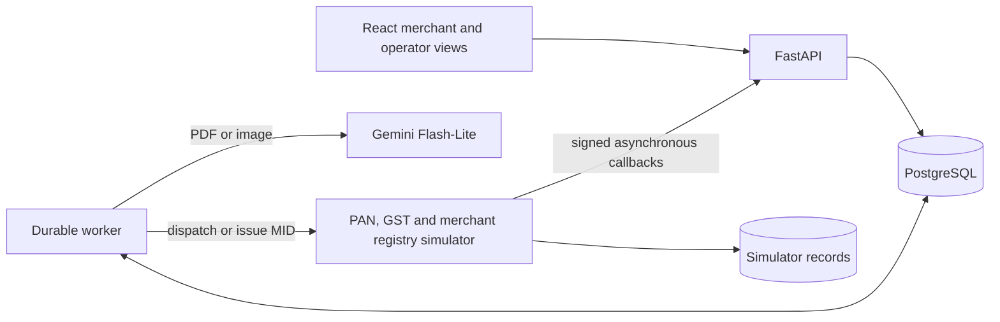

# Merchant desk

Merchant desk implements the Pine Labs **Autonomous Merchant Onboarding Platform** case study.

A merchant submits a PAN record and a GST certificate. The desk reads the evidence, compares it with the form and sends two independent verification requests. An inactive GST registration gives the operator a specific reason to request a replacement. A successful correction can activate the merchant automatically.

## Run the demo

From the repository root, with Docker Compose available, run

```sh
docker compose up --build --wait -d
```

Open [Merchant desk](http://localhost:8018). Under **Merchant portal → New application**, choose a sample and submit. All four PNGs are available under **Download test documents**.

| Sample | Evidence | What to look for |
| --- | --- | --- |
| **Load clean sample** | Riverbend Stationery’s `pan-stat.png` and `gst-stationary.png` | With Gemini configured, all four fields matched in the tested run. The PAN and GST callbacks both passed and the application reached **Active** with one merchant ID. |
| **Load mismatched sample** | `pan.png` names Sample Kumar. `gst-cert.png` names Sample Enterprises Private Limited. | The holder conflicts with the declaration and the printed GSTIN has 14 characters. The application goes to **Needs review** before either provider is called. This is also the starter case. |
| **Load inactive registration** | Structured PAN and GST records for Riverbend | PAN passes and GST reports an inactive registration. The merchant can correct it and reach approval without an API key. |

Open **Evidence** to compare declarations with extracted fields and inspect their source. **Verification** shows the provider attempts and callback receipts. For the clean image demo, enable Gemini using the steps below. In the offline OCR test, the watermark interfered with the PAN holder name and the reader missed the GST legal name, which routed the case to review.

### Correct an inactive GST registration

1. Open **Merchant portal → New application**, choose **Load inactive registration**, and submit. In **Operator view**, the PAN check passes and the GST simulator reports **GST registration inactive**.
2. Choose **Request current certificate → Send request**. Open the merchant correction, choose **Load current GST record**, and submit.
3. Once the case is **Active**, open **Operator view → Verification**. The history shows one PAN attempt, two GST attempts and one merchant ID.
4. Choose **Replay latest callback**. The receipt shows two deliveries and the MID stays the same. **Activity** shows the approval and issuance.

The provider simulator also offers a late first GST callback and a lost first MID response.

## Gemini extraction

With a configured key, the worker sends the original PDF, PNG, JPEG or WebP to `gemini-flash-lite-latest`. Gemini identifies PAN, GST, mixed or unrelated evidence and returns field candidates with a source page, a quote and an uncertainty flag. Its prompt receives the document and the response schema. Declared form values are compared afterwards in Python.

To enable Gemini on a fresh checkout, copy `.env.example` to `.env`, set `GEMINI_API_KEY` there, then run `docker compose up -d --force-recreate worker`. Compose passes the credential to the worker. The key file is excluded from Git and Docker builds. Use synthetic evidence for this demo. Google lists standard Flash-Lite input and output under its free tier. Quotas and billing apply to the Google project that owns the key. [Google's model pricing](https://ai.google.dev/gemini-api/docs/pricing#gemini-3.5-flash-lite)

Each Gemini reading records the model version supplied by Google. To check its field values and source references against both pairs of specimen images, run

```sh
docker compose exec worker python -m desk.check_gemini
```

| Evidence | How the desk handles it |
| --- | --- |
| Structured JSON | Reads the supplied PAN or GST fields directly and records the JSON key as the source. |
| Binary upload with Gemini | Accepts up to two files, each at most 6 MiB. PDFs may have up to eight pages and images up to ten megapixels. A supported type can arrive with an unfamiliar filename or layout. |
| Missing key or provider outage | The local reader extracts labelled text from digital PDFs and runs Tesseract on images. It recognises PAN card headings and GST REG-06 registration rows. A watermarked identifier can remain unreadable. When a provider error triggers fallback, the case records the reason. |
| Unclear or inconsistent evidence | Unknown and mixed documents go to review. Unreadable or missing fields prompt correction. A model quote must contain its candidate value. For PDFs with a text layer, the quote must also occur on the cited page. For scans, the reviewer can inspect the original pixels. |

## How a decision is made



- PostgreSQL stores submissions, versioned evidence, verification attempts, receipts, audit events and durable jobs. Each application snapshots its required checks. Work claims have a lease. A separate consumer handles document reading so model latency does not delay provider dispatch or issuance.
- The simulator has separate PAN and GST HTTP endpoints. Each accepts an attempt, persists its callback schedule and returns `202`. The callback signature covers the raw HTTP body. Receipts store delivery counts and whether the result was applied, late or superseded.
- The workflow locks the application row before changing a decision. A changed input invalidates only the checks that depend on it. Approval requires valid evidence and every configured check passing for its current inputs. Approval and its MID job commit together.
- The registry uses the application ID as its idempotency key. Losing an issuance response triggers a retry that recovers the same MID. Timed-out checks start new attempts, exhausted retries surface in the operator queue, and the original result remains in the history.

The lifecycle is `SUBMITTED → VERIFYING → APPROVED → ACTIVE`, with `IN_REVIEW` for operator intervention, `NEEDS_INFO` for merchant corrections and `REJECTED` for a closed exception. The API exposes the reason, next actor, allowed actions and expected version for edits. A stale edit receives HTTP 409. See the [interactive API reference](http://localhost:8018/docs).

## Tests

With the Compose demo running, the following command creates a disposable PostgreSQL database, applies migrations, runs the extraction and workflow tests with local OCR, then removes that test database.

```sh
sh scripts/test.sh
```

The suite exercises source grounding, low-confidence readings, wrong types, quota and authentication failures, stale revisions, concurrent callbacks, duplicate delivery, deadlines, lease recovery, lost MID responses and role/ownership checks. Its Gemini responses are controlled locally. The separate live smoke test above contacts Google.

For the browser suite, install Node.js 22.12 or newer and run

```sh
cd frontend
npm ci
npx playwright install chromium --only-shell
npm run test:e2e
```

The end-to-end suite covers the full correction and replay journey, mobile document viewing, late callbacks, lost issuance responses, cross-tab identity changes, stale corrections and PAN replacement requests. Binary uploads use the reader configured on the running worker.

## Hardening

Compose publishes the desk on loopback. A one-shot migration process provisions separate database logins for the workflow and provider simulator. The worker receives the simulator request credential and, when configured, the Gemini key. Only the API holds the browser session signing key. The existing database and session-key volumes carry forward during a normal rebuild.

## Scope

The app models one cohort of GST-registered merchants. PAN and GST are simulated registries with one fictional business and two registration records. The local demo uses switchable signed-cookie identities, server-side role and ownership checks, and private evidence storage. Bank and risk providers, duplicate-entity matching, production identity management and compliance retention policies are outside this build.
