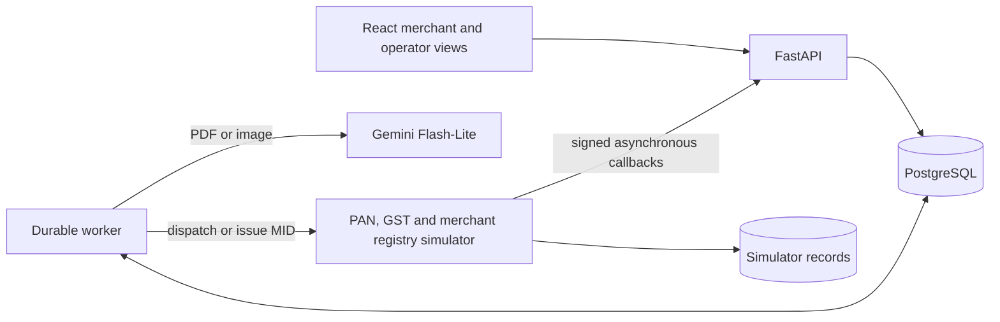

# Merchant desk

A merchant submits a PAN record and a GST certificate. The desk reads the evidence, compares it with the form and sends two independent verification requests. An inactive GST registration gives the operator a specific reason to request a replacement. A successful correction can activate the merchant automatically.

## Run the demo

From the repository root, with Docker Compose available, run

```sh
docker compose up --build --wait -d
```

Open [Merchant desk](http://localhost:8018). The first run creates a synthetic Riverbend Stationery application. Within a few seconds its PAN check should pass and its GST check should report **GST registration inactive**. The two workspace buttons switch between the demo operator and merchant. The case, evidence and history persist across restarts.

1. Open **Evidence**. Compare the declared and extracted GSTIN. Select the source page to inspect the document that supplied it.
2. Choose **Request current certificate**, then **Send request**. Open the merchant correction, choose **Load current certificate**, and submit.
3. When the case becomes **Active**, open **Operator view → Verification**. The history shows one PAN attempt and two GST attempts. The active case has one merchant ID.
4. Choose **Replay latest callback**. The receipt shows two deliveries. Refresh to see the same MID and open **Activity** to inspect the approval and issuance.

To start at intake, open **Merchant portal → New application**. **Load review sample** exercises the exception. **Load clean sample** uses the active GSTIN from the outset. The simulator also offers a late first GST callback and a lost first MID response.

## Gemini extraction

With a configured key, the worker sends the original PDF, PNG, JPEG or WebP to `gemini-flash-lite-latest`. Gemini identifies PAN, GST, mixed or unrelated evidence and returns field candidates with a source page, a quote and an uncertainty flag. Its prompt receives the document and the response schema. Declared form values are compared afterwards in Python.

To enable Gemini on a fresh checkout, copy `.env.example` to `.env`, set `GEMINI_API_KEY` there, then run `docker compose up -d --force-recreate worker`. Compose passes the credential to the worker. The key file is excluded from Git and Docker builds. Use synthetic evidence for this demo. Google lists standard Flash-Lite input and output under its free tier. Quotas and billing apply to the Google project that owns the key. [Google's model pricing](https://ai.google.dev/gemini-api/docs/pricing#gemini-3.5-flash-lite)

On **21 November 2026**, the live alias returned `gemini-3.5-flash-lite`. The reader returned the expected legal name, GSTIN, page and quote for the unfamiliar-layout registry letter and the digital certificate. It classified an unrelated shape drawing as `OTHER` and withheld the obscured GSTIN in a scan. Each reading records the model version supplied by Google. Repeat the live smoke test on the letter and certificate with

```sh
docker compose exec worker python -m desk.check_gemini
```

Open **Download test documents** on the intake or correction screen to try other layouts. For example, load a clean application, remove `gst-current.pdf`, then upload `registry-letter.jpg`. The same active registration appears in the body of a letter. `gst-scan-obscured.png` covers a character in the identifier.

| Evidence | How the desk handles it |
| --- | --- |
| Structured JSON | Reads the supplied PAN or GST fields directly and records the JSON key as the source. |
| Binary upload with Gemini | Accepts up to two files, each at most 3 MiB. PDFs may have up to eight pages and images up to ten megapixels. A supported type can arrive with an unfamiliar filename or layout. |
| Missing key or provider outage | The local reader can read labelled digital PDFs and run Tesseract on labelled images. When it recovers from a provider error, the case shows the fallback method and reason. A provider failure with unusable fallback evidence needs a technical retry. |
| Unclear or inconsistent evidence | Unknown and mixed documents go to review. Unreadable or missing fields prompt correction. A model quote must contain its candidate value. For PDFs with a text layer, the quote must also occur on the cited page. For scans, the reviewer can inspect the original pixels. |

## How a decision is made



- PostgreSQL stores submissions, versioned evidence, verification attempts, receipts, audit events and durable jobs. Each application snapshots its required checks. Work claims have a lease. A separate consumer handles document reading so model latency does not delay provider dispatch or issuance.
- The simulator has separate PAN and GST HTTP endpoints. Each accepts an attempt, persists its callback schedule and returns `202`. The callback signature covers the raw HTTP body. Receipts store delivery counts and whether the result was applied, late or superseded.
- The workflow locks the application row before changing a decision. A changed input invalidates only the checks that depend on it. Approval requires valid evidence and every configured check passing for its current inputs. Approval and its MID job commit together.
- The registry uses the application ID as its idempotency key. Losing an issuance response triggers a retry that recovers the same MID. Timed-out checks start new attempts, exhausted retries surface in the operator queue, and the original result remains in the history.

The lifecycle is `SUBMITTED → VERIFYING → APPROVED → ACTIVE`, with `IN_REVIEW` for operator intervention, `NEEDS_INFO` for merchant corrections and `REJECTED` for a closed exception. The API exposes the reason, next actor, allowed actions and expected version for edits. A stale edit receives HTTP 409. See the [interactive API reference](http://localhost:8018/docs).

## Tests

With the Compose demo running, the following command creates a disposable PostgreSQL database, applies migrations, runs the extraction and workflow tests with local OCR, then removes that test database.

```sh
sh scripts/test.sh
```

The suite exercises source grounding, low-confidence readings, wrong types, quota and authentication failures, stale revisions, concurrent callbacks, duplicate delivery, deadlines, lease recovery, lost MID responses and role/ownership checks. Its Gemini responses are controlled locally. The separate live smoke test above contacts Google.

For the browser suite, install Node.js 22.12 or newer and run

```sh
cd frontend
npm ci
npx playwright install chromium --only-shell
npm run test:e2e
```

The end-to-end suite submits a new demo application through the UI, runs the correction and replay journey, and checks the mobile document viewer. Two additional tests use the simulator's HTTP deliveries to verify recovery from a late GST callback and a lost MID response. The browser's binary uploads use the reader configured on the running worker. The main correction journey also passed on a fresh database with the local reader alone.

## Scope

The app models one cohort of GST-registered merchants. PAN and GST are simulated registries with one fictional business and two registration records. The local demo uses switchable signed-cookie identities, server-side role and ownership checks, and private evidence storage. Bank and risk providers, duplicate-entity matching, production identity management and compliance retention policies are outside this build. [Case study](PS.md) · [Development plan](DEVELOPMENT_PLAN.md)
